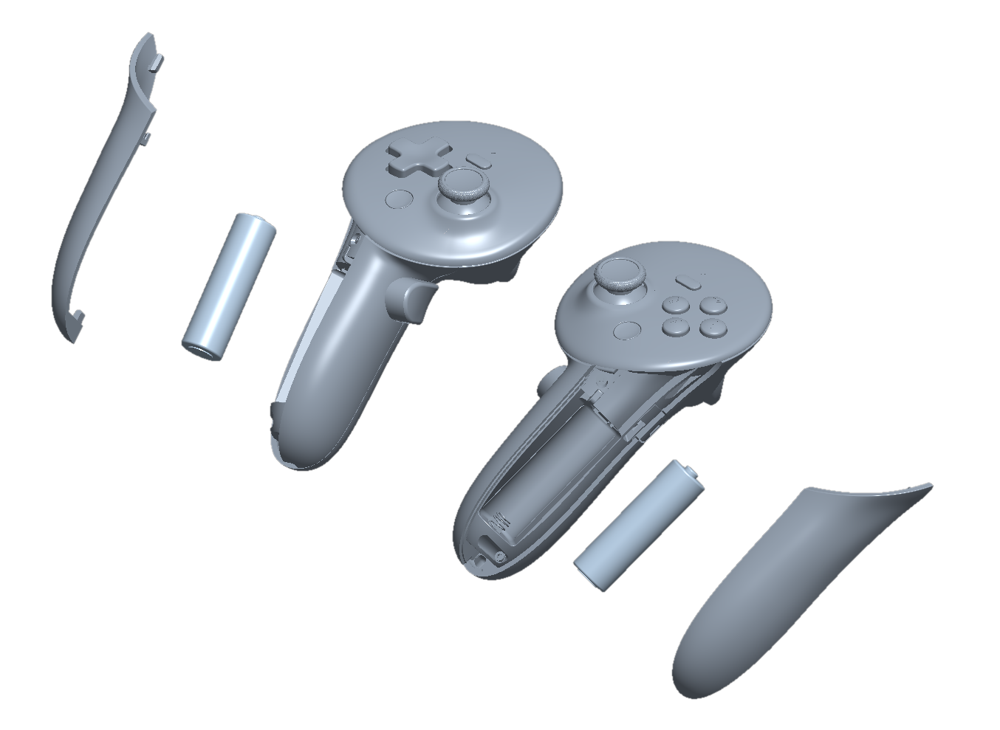
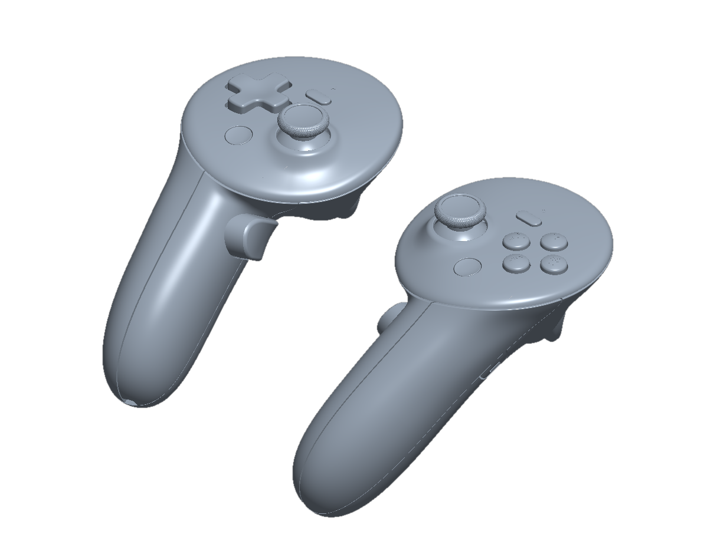
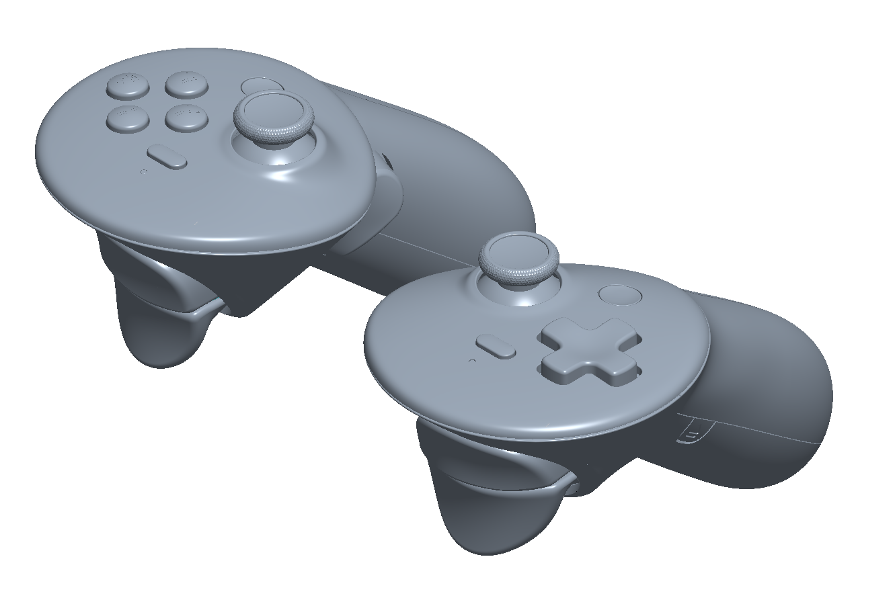
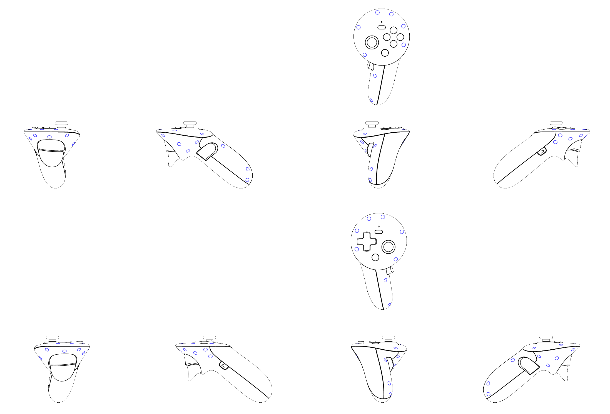

# Steam Frame Hardware Reference

> [!WARNING]
> Information provided within this repository is for informational purposes only. The reference material is provided on an AS-IS basis. Valve Corporation reserves the right to change hardware designs in any way. Valve is not responsible for any damage to hardware that may arise from the use of mechanical or electrical interfaces to the Steam Frame that are not "Steam Frame Compatible."  This includes opening or making modifications to the Steam Frame. Content provided in this repository may not be used for commercial purposes. If you wish to pursue a commercial license please reach out to us at steamframecompatible at valvesoftware com.  Please refer to the license.txt document in this repository for all terms and conditions.

This repo contains:
1. Documents for interfacing to the expansion port. **Please read all warnings if designing your own hardware to interface to the expansion port.** This is in the [documents-expansion-port](documents-expansion-port/) folder. 
2. Stripped down CAD of the core module, in the [documents-coremodule](documents-coremodule/) folder.
3. A full USB 3.0 Hub example, built in Altium, found in the [example-expansion-port-full-usb-3.0](example-expansion-port-full-usb-3.0/) folder.
4. A minimal USB 3.0 Hub example, built in KiCad, found in the [example-expansion-port-short-usb](example-expansion-port-short-usb/)
5. Stripped down CAD of the headstrap, in the [documents-headstrap](documents-headstrap/) folder.
6. LED Locations for the controllers in [documents-controller/Steam_Frame_Controller_LED_Locations](documents-controller/Steam_Frame_Controller_LED_Locations.pdf)
7. Controller CAD in [documents-controller](documents-controller)

