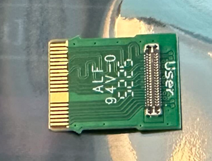
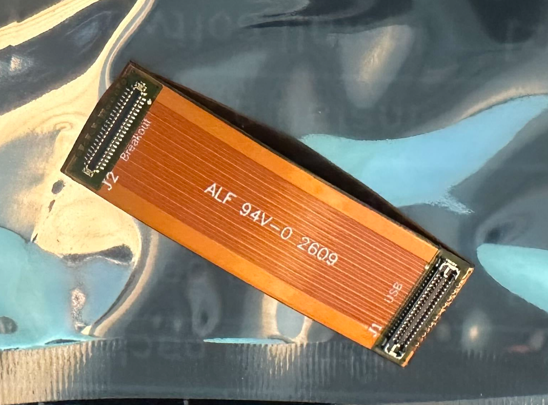
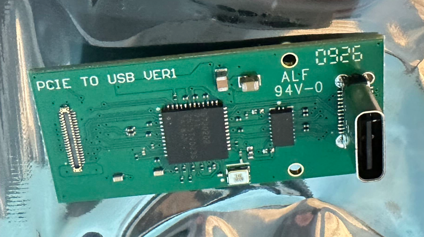

# Full Expansion Port Example

This project is split into 3 parts.

Part 1: The breakout. Interfaces the port to a board-to-board (mezzanine) connector. This enables all pins to pass through to other devices

Part 2: The flex. We feel in most applications it makes the most sense to use a flex to where the main board that will be interfacing to PCI-Express will be mounted, we recommend a flex.  This takes the signals to where they are needed.

Part 3: The PCI to USB adapter. This is an example device that uses the UPD720202K8-711. It also contains an EEPROM to uniquely identify the board. For any non-standard devices EEPROM is critical to identification.

